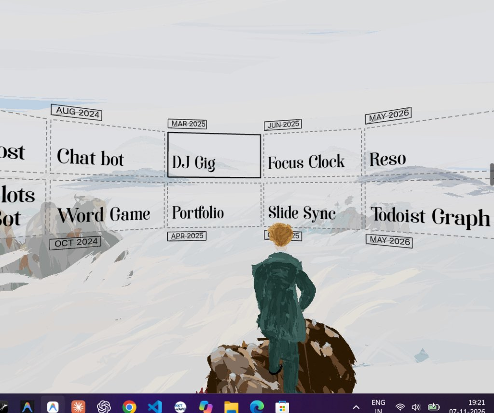

# Hey 👋, I'm Tarun Uttupulusu

  <b>Frontend Engineer • Creative Developer • Full Stack Explorer</b>

  
  
  

---

### 🏔️ Interactive 3D Projects Showcase

  

  ✨ <i>Inspired by Caspar David Friedrich's "Wanderer above the Sea of Fog"</i>

---

### 👨‍💻 About Me

I am a developer who loves building interactive 3D web experiences, clean user interfaces, and scalable applications.

- 🔭 Currently building creative Three.js & full-stack web applications
- 🌱 Exploring WebGL shaders, Three.js, React Three Fiber, and high-performance frontend architectures
- 💬 Ask me about **React, Next.js, Three.js, TypeScript, and UI Engineering**
- ⚡ Fun fact: Creative coding turns code into living art!

---

### 🛠️ Tech Stack

  

---

### 📬 Connect With Me

  
  

